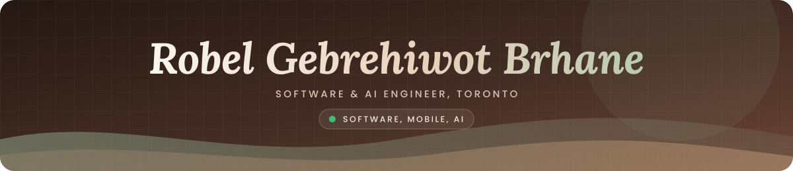

  

  

  
  
  
  

---

### 🧭 Right now

- 🍽️ **Offering Meal Checker Application** free of charge to organizations that serve meals to their communities
- ⌨️ **Testing the Tigrigna Keyboard**, a native Android and iOS keyboard with handwriting recognition, with 11 testers
- 🎓 **Finishing** an MSc in AI and Computer Science at the University of Calabria

My work experience is on my <a href="https://robel-gh.github.io/resume/robel-resume.pdf">résumé</a> and <a href="https://robel-gh.github.io/experience">portfolio</a>.

### 🚀 Projects you can explore

<table>
  <tr>
    <td width="50%" valign="top">
      <h3>🩺 <a href="https://github.com/Robel-GH/Clinical-RAG-Medical-Assistant">Clinical RAG Assistant</a></h3>
      Answers medical questions from WHO guidelines, cites its sources, and says so when it finds no evidence instead of guessing. Hybrid BM25 and dense retrieval, with an agent that drafts, critiques and revises.
        
      
      
      
      
    </td>
    <td width="50%" valign="top">
      <h3>🩻 <a href="https://github.com/Robel-GH/medical-report-generation">Chest X-ray Report Generation</a></h3>
      Drafts the Findings and Impression sections of a radiology report from a chest X-ray, using a ResNet-50 image encoder and a GPT-2 text decoder trained on the open IU X-ray dataset.
        
      
      
      
    </td>
  </tr>
  <tr>
    <td width="50%" valign="top">
      <h3>🧩 <a href="https://github.com/Robel-GH/Keke">Keke AI Competition</a> 🥈</h3>
      A search agent for a puzzle game whose rules can be rewritten mid-game. <b>2nd place</b>, solving 94% of the hidden levels (team project).
        
      
      
    </td>
    <td width="50%" valign="top">
      <h3>💬 <a href="https://github.com/Robel-GH/Unical-Phonebook-and-Messaging">Unical Phonebook & Messaging</a></h3>
      A university directory with real-time messaging, role-based access and privacy controls for students and staff (team project).
        
      
      
      
    </td>
  </tr>
  <tr>
    <td width="50%" valign="top">
      <h3>🌍 <a href="https://github.com/Robel-GH/Earthquake-Data-Warehouse-Project">Earthquake Data Warehouse</a></h3>
      An ETL pipeline that loads USGS earthquake data into a PostgreSQL warehouse, with Tableau dashboards on top.
        
      
      
      
    </td>
    <td width="50%" valign="top">
      <h3>🛰️ <a href="https://github.com/Robel-GH/Dynamic-PDDL-Visualizer">Dynamic PDDL Visualizer</a></h3>
      A 3D tool that animates AI planning domains, so you can watch a plan play out step by step.
        
      
      
      
    </td>
  </tr>
</table>

### 🔒 Also building (not public yet)

  
  
  
  

These and my client work are described on my <a href="https://robel-gh.github.io/projects">portfolio</a>.

### 🧰 Tech I use

<table align="center">
  <tr>
    <td align="right"><b>Languages</b></td>
    <td></td>
  </tr>
  <tr>
    <td align="right"><b>Frontend</b></td>
    <td></td>
  </tr>
  <tr>
    <td align="right"><b>Backend</b></td>
    <td></td>
  </tr>
  <tr>
    <td align="right"><b>AI &amp; data</b></td>
    <td> 
      
      
      
      
      
    </td>
  </tr>
  <tr>
    <td align="right"><b>Mobile</b></td>
    <td></td>
  </tr>
  <tr>
    <td align="right"><b>Databases</b></td>
    <td></td>
  </tr>
  <tr>
    <td align="right"><b>DevOps &amp; tools</b></td>
    <td> 
      
    </td>
  </tr>
</table>

---

  <b>Are you hiring a software, mobile or AI engineer in Canada or remote?</b> 
  The fastest way to reach me is <a href="mailto:robelghb@gmail.com">robelghb@gmail.com</a>.

  

